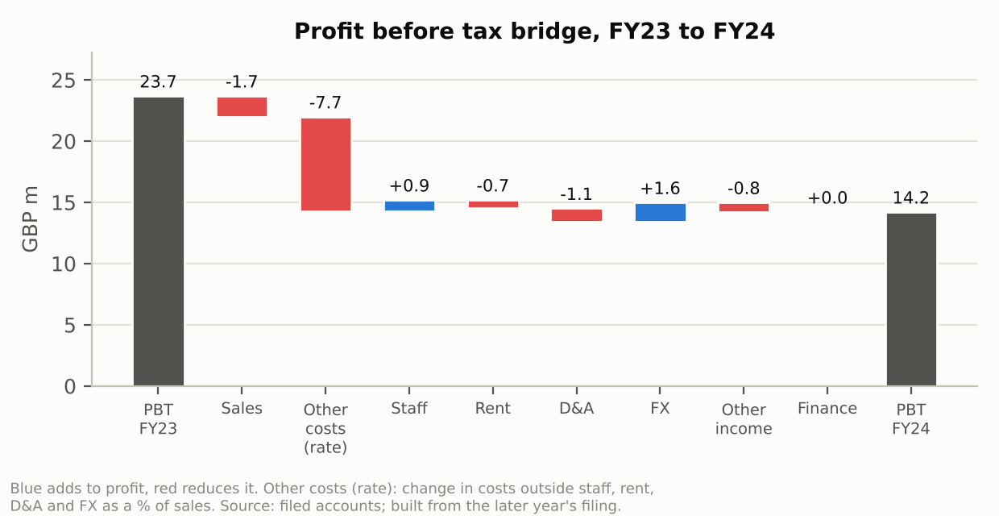

# retail-commercial-finance-lab

Commercial finance analysis of Mint Velvet built on its filed accounts. It has two parts: a profit bridge from FY22 to FY25 that reconciles to reported profit before tax to the pound, and a new-store appraisal model. Each part comes with a live-formula Excel workbook that is recalculated in CI and must match the Python engine.

> Independent analysis of public filings. Not affiliated with or endorsed by Mint Velvet or Sabre Retail Fashion Limited. The store model is illustrative: Mint Velvet's store-level data is not public, so its outputs are not Mint Velvet's store economics.

| Deliverable | File |
|---|---|
| Two-page review: FY22-FY25 performance and a 1,700 sq ft store appraisal | [`outputs/performance_review.pdf`](outputs/performance_review.pdf) |
| Profit bridges (function and nature views), ratios and the full source ledger, in live formulas | [`outputs/bridge.xlsx`](outputs/bridge.xlsx) |
| Store appraisal: Inputs, Payroll, Store P&L, Returns, Sensitivity | [`outputs/store_model.xlsx`](outputs/store_model.xlsx) |
| Findings with page references | [`docs/findings.md`](docs/findings.md) |
| Every figure with its PDF page and verification status | [`docs/source_registry.md`](docs/source_registry.md) |
| Restatements, internal inconsistencies, press cross-check | [`docs/discrepancies.md`](docs/discrepancies.md) |

## Key findings

1. **Each pound of lost sales cost about two pounds of operating profit.** Turnover fell 6.2% from FY22 to FY24 and PBT fell 53.7% (GBP 30.7m to GBP 14.2m). FY25 recovered: turnover +11.5%, PBT +41.9%.
2. **The 'other operating costs' pool drove the fall, not payroll or rent.** Costs outside staff, rent, D&A and FX went from 62.6% to 72.2% of turnover, which explains 81% of the FY24 profit fall. The filings do not split this pool after FY22, the only year with a disclosed product margin (71.0%).
3. **Payroll is the next pressure.** FY25 staff costs rose 19.1% against 11.5% sales growth. Employer social security reached 9.6% of wages, and the April 2025 NIC change covered only about 38 of FY25's 52 weeks.
4. **New store, what has to be true.** A 1,700 sq ft regional-mall unit needs **GBP 424 per sq ft a year** (GBP 0.72m) to return a 10% hurdle over a 10-year lease under base costs. Under downside costs it needs GBP 677 per sq ft.



Turnover growth against the ONS clothing and footwear stores index: -10.3ppt in FY23, -1.4ppt in FY24, +8.3ppt in FY25 ([`outputs/charts/market.png`](outputs/charts/market.png)). The full set of five findings is in [`docs/findings.md`](docs/findings.md).

## Data

- **Filed accounts, FY22-FY25.** Sabre Retail Fashion Limited (company 07920155, trades as Mint Velvet), from [Companies House](https://find-and-update.company-information.service.gov.uk/company/07920155/filing-history). The four 52-week periods end on 31 Dec 2022, 30 Dec 2023, 28 Dec 2024 and 27 Dec 2025, all under FRS 102. The PDFs are scanned page images with no text layer and no iXBRL version. Every figure is transcribed into [`data/ledger/transcription.csv`](data/ledger/transcription.csv) with its PDF page; `make extract` then OCRs each cited page and fails if a number is not on it. All 454 figures are confirmed: by OCR on the cited page or, where OCR misreads the scan, by an exact accounting identity (status per figure in the source registry).
- **Market:** [ONS Retail Sales Index v45](https://www.ons.gov.uk/datasets/retail-sales-index/editions/time-series/versions/45): Great Britain, seasonally adjusted value and volume, textile, clothing and footwear stores (Open Government Licence).
- **Statutory rates:** 2026/27 NLW, employer NIC and threshold, auto-enrolment, holiday entitlement and business-rates multipliers, linked in [`config/assumptions.yaml`](config/assumptions.yaml).

## Method

Bridges are exact identities built from each year's own filing (function view from the P&L face; nature view from the notes, with the residual 'other operating costs' pool named and sized, not plugged). The store model is a 10-year lease cash flow with bottom-up payroll from 2026/27 statutory rates and a break-even density solved exactly. Details, including how the workbooks are recalculated and checked against Python: [`docs/method.md`](docs/method.md).

## Store model inputs (base case)

Every input has a basis. SOURCED means a public source; FILING_PROXY means derived from the filed accounts (company-wide averages, and upper bounds for rent, capex and stock); ASSUMPTION means an analyst assumption to be replaced with internal data. The full list of 45 inputs is in [`docs/assumptions.md`](docs/assumptions.md).

| Input | Base | Range | Basis |
|---|---|---|---|
| mature_sales_density | GBP 850/sq ft | GBP 600/sq ft to GBP 1,100/sq ft | ASSUMPTION |
| ramp_year1 | 80.0% | 70.0% to 90.0% | ASSUMPTION |
| product_gross_margin | 71.0% | 66.0% to 74.0% | FILING_PROXY |
| rent_per_year | GBP 95,340 | GBP 70,000 to GBP 200,000 | FILING_PROXY |
| rateable_value | GBP 55,000 | GBP 40,000 to GBP 90,000 | ASSUMPTION |
| other_opex_pct_sales | 10.0% | 6.0% to 15.0% | ASSUMPTION |
| fitout_capex | GBP 528,000 | GBP 323,333 to GBP 931,500 | FILING_PROXY |
| stock_pct_sales | 10.0% | 8.2% to 12.4% | FILING_PROXY |
| dilapidations_at_exit | GBP 26,604 | GBP 8,271 to GBP 40,000 | FILING_PROXY |
| lease_term_years | 10 years | 5 years to 15 years | ASSUMPTION |
| discount_rate | 10.0% | 8.0% to 14.0% | ASSUMPTION |
| nlw_hourly | GBP 12.71 | - | SOURCED |
| employer_nic_rate | 15.0% | - | SOURCED |

## What this does not show

- Store-level, channel or like-for-like performance. None of it is disclosed.
- Variance against budget or forecast. No budget is public.
- Product margin after FY22. FY22 is the only filing that discloses cost of stock.
- Marketing ROI. No marketing spend is disclosed.
- Mint Velvet's actual store economics. The store model's outputs depend on labelled assumptions.

## Run it

Requires Python 3.11+, Tesseract and Poppler (OCR check), and LibreOffice (workbook parity test).

```bash
sudo apt-get install tesseract-ocr poppler-utils libreoffice-calc   # or the platform equivalent
pip install -e ".[dev]"
make all     # verify the ledger against the PDFs, build workbooks, charts, docs and the PDF
make test
```

To appraise a real site, edit [`config/assumptions.yaml`](config/assumptions.yaml) (or the blue cells in the workbook's Inputs sheet) with the heads-of-terms rent, the VOA rateable value, the fit-out quote and the staffing plan, then rerun `make all`.

## Layout

```
config/assumptions.yaml        store model inputs: value, unit, basis, low, high, source
data/raw/                      filed accounts (4 PDFs) and the ONS workbook
data/ledger/transcription.csv  every figure used, with PDF page and printed page
data/processed/                financials.csv, verification.csv, discrepancies.csv (generated)
src/rcfl/                      extract (OCR check), bridge, ratios, market, payroll, store_model,
                               excel_export, charts, report
tests/                         pytest suite, incl. LibreOffice parity tests
outputs/                       workbooks, CSVs, charts, performance_review.pdf (generated)
docs/                          findings, source registry, discrepancies, assumptions (generated)
```

MIT licence (code). README, docs and outputs are generated by `make all` from the ledger and `config/assumptions.yaml`.
